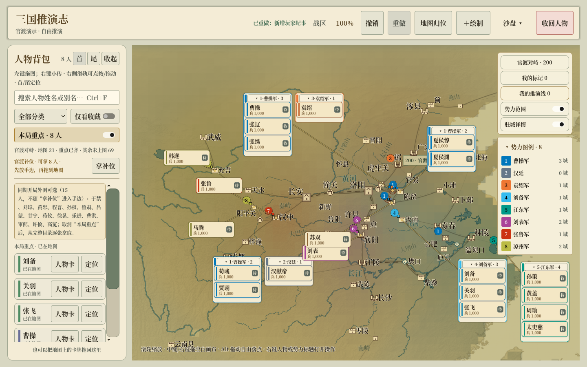
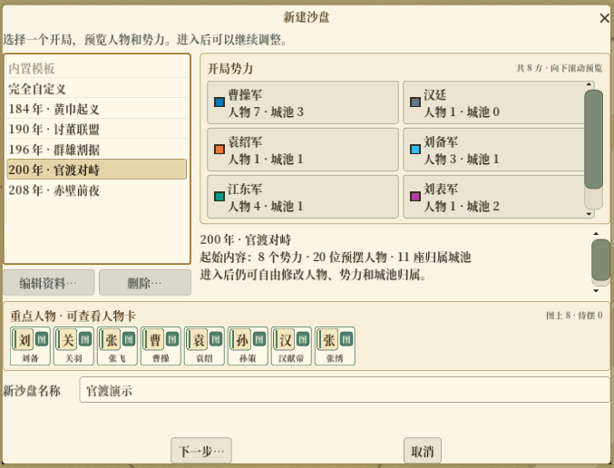
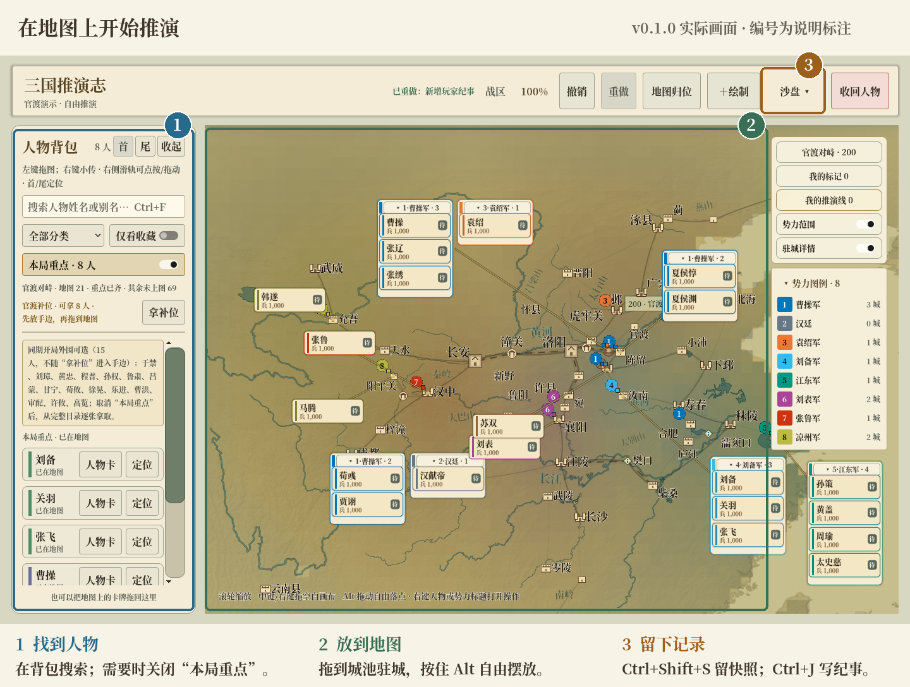
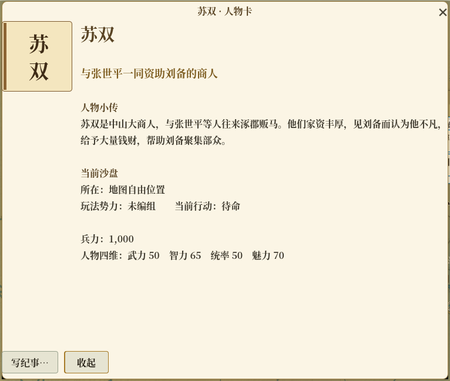
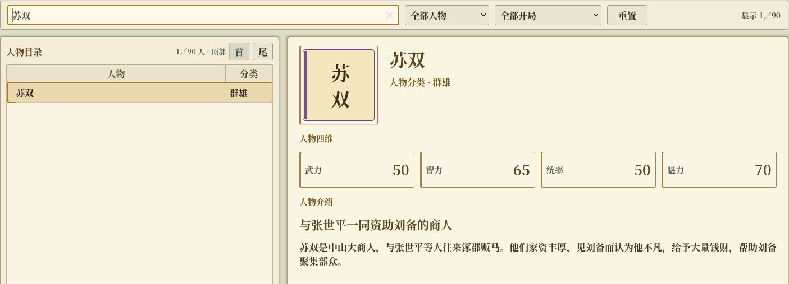

# 三国推演志

把人物卡摆到大地图上，自己推演一段三国。

**[下载 Windows 版 · v0.1.0](https://github.com/minkaiwang/sanguo-sandtable/releases/download/v0.1.0/sanguo-sandbox-v0.1.0-reviewed-windows-x64.zip)**　[版本说明与源码](https://github.com/minkaiwang/sanguo-sandtable/releases/tag/v0.1.0)　[反馈问题](https://github.com/minkaiwang/sanguo-sandtable/issues)



*官渡开局的演示局面。以下图片来自 v0.1.0 实际运行画面；局部图经过裁切，操作图另加了编号标注。*

这是一个离线单机沙盘。你来决定人物去哪、属于哪一方、发生了什么，再用快照和纪事留下故事。战事和剧情由玩家裁定。

**90个人物 · 6个开局 · 53个地点 · 66条地点关系**

## 下载后，先玩一局

完整解压 Windows 包，双击 `SanguoSandtable.exe`。同目录的 `SanguoSandtable.pck` 是游戏资源文件，请放在一起。

### 1. 选一个开局

从“完全自定义”开始自己摆，也可以选择黄巾起义、讨董联盟、群雄割据、官渡对峙或赤壁前夜。选中后能先看人物和势力，再点“下一步”。

<p align="center">
  
</p>

### 2. 找到人物，放到地图上

在左侧背包搜索人物，取到手边后拖到地图。拖到城池可以驻城，按住 `Alt` 可以自由摆放。历史开局默认筛选“本局重点”；找不到想要的人时，先关闭这个筛选。



滚轮缩放，中键拖动视角。右键人物卡可以查看资料或调整分组，摆错了可以撤销。

### 3. 留下这个局面，写下后续

按 `Ctrl+Shift+S` 留下一份命名快照，按 `Ctrl+J` 打开纪事。也可以从人物卡的“写纪事…”进入，记录这位人物的计划和经历。

<p align="center">
  
</p>

## 人物志里能看到什么？

按姓名、分类或开局查找人物，阅读小传和参考四维。这里不只收将领，也有苏双这样的商人；四维是游戏参考值，可在本局调整。



## 常用操作

| 想做什么 | 操作 |
| --- | --- |
| 找人 | 背包搜索框；`Ctrl+F` 聚焦搜索 |
| 摆放 | 从背包取出并拖到地图；`Alt` 自由摆放 |
| 看小传、改分组 | 右键人物卡 |
| 调整地图视角 | 滚轮缩放，中键拖动 |
| 撤销、重做 | 顶部按钮，或 `Ctrl+Z`／`Ctrl+Y` |
| 留住此刻 | `Ctrl+Shift+S` |
| 写纪事 | `Ctrl+J` 或人物卡“写纪事…” |
| 画线、做标记 | 顶部“绘制” |
| 导入导出、回到标题 | 顶部“沙盘”菜单 |

## 存档在哪里？

操作会自动保存。Windows存档目录是：

```text
%APPDATA%\Godot\app_userdata\天下沙盘
```

关闭游戏后复制整个目录，可备份本机状态；游戏内“备份当前沙盘”可导出单个 `.tianxia` 文件。当前存档格式v18、人物目录v6；读取支持的旧档时先备份再迁移，升级后的存档请继续用新版打开。

## 开发与测试

<details>
<summary>展开：从源码运行、测试和导出</summary>

使用Godot 4.7.x打开 `project.godot`，等待资源导入后按F5。项目使用GDScript，无需C# SDK或API密钥。

| 目录 | 内容 |
| --- | --- |
| `src/` | 游戏代码 |
| `scenes/` | 场景 |
| `data/` | 人物与地图资料 |
| `assets/` | 素材 |
| `tests/` | 自动测试 |

在Windows的PowerShell 7中运行测试：

```powershell
pwsh -File tools/test.ps1 -GodotPath 'C:\Tools\Godot\godot.exe'
```

测试覆盖人物搜索与拖放、开局切换、存档迁移、快照和备份、撤销重做、未保存编辑的离开保护。加 `-Capture` 可运行界面检查并将截图存入 `artifacts/release/`。

安装与编辑器版本对应的导出模板后，可生成Windows程序：

```powershell
New-Item -ItemType Directory -Force builds | Out-Null
& 'C:\Tools\Godot\godot.exe' --headless --path . --export-release 'Windows Desktop' builds/SanguoSandtable.exe
```

</details>

## 当前版本与反馈

人物库仍在补充，史实与演义尚未提供完整的分栏对照。地图采用全国尺度代表位置，适合摆放和阅读局势。当前主要验证Windows；其他平台和长时间游玩仍需测试。

欢迎通过 [Issues](https://github.com/minkaiwang/sanguo-sandtable/issues) 反馈问题。写上复现步骤、操作系统和游戏版本，有截图会更容易定位；提供存档前可先去掉私人纪事。

代码与项目自有SVG采用MIT许可。字体、图标及资料的来源和许可见 [THIRD_PARTY_NOTICES.md](THIRD_PARTY_NOTICES.md) 与 [LICENSES/](LICENSES/)。
